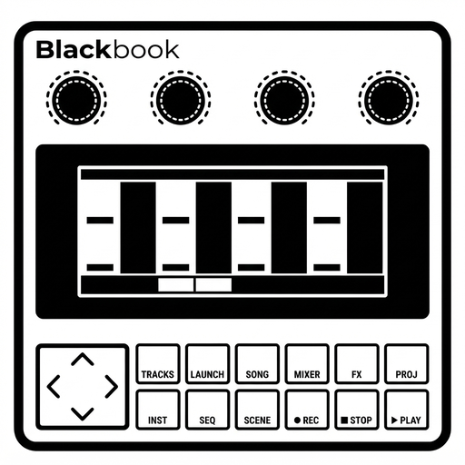

#  blackbook

**blackbook** is an unofficial organizer for the microSD card of the **1010music blackbox 2**. It runs on your computer and opens in your web browser. Nothing is uploaded anywhere.

> [!IMPORTANT]
> **This is a very, very, very early version.** Expect rough edges and missing pieces. It is shared now so you can try it and tell me what you need. Every idea and every bug report helps: [Ideas and feedback](https://github.com/nightanvil/blackbook/issues).

blackbook is free and stays free. If it helps you, you can buy me a coffee on [Ko-fi](https://ko-fi.com/nightanvil).

> [!TIP]
> **blackbook updates itself.** You install it once. When a new version is out, blackbook shows a bar at the top: click **Update now**, then **OK**, and start blackbook again. No new download, no new setup, your settings and your backup stay. Details: [Updating](#updating).

**Roadmap**

| Status | What |
|---|---|
| In progress | One-shot patches complete: filter, envelope, LFO, sends, launch, poly |
| Next | Slicer, loop, shredder, multisample loop points, waveform view |
| Later | External audio editor (Reaper), project tools (pack, clean, rename), sample organization, card and firmware tools |
| Done | Library, tags, one-shot and multisample basics, backup, installer, updates |

## What it does

- **Library:** all factory and user patches with type and tag filter. Listen to samples and previews.
- **Tags:** tag your own patches, as on the device.
- **Build:** one-shot kits on 16 pads with all pad settings of the device (sound, setup, envelope, LFO, start and length), and multisample instruments, by drag and drop. Key and velocity ranges are read from the file names.
- **Edit:** change your own patches in place. Sequences, modulation and everything blackbook does not know stay untouched.
- **Templates:** any one-shot or multisample patch, also factory patches, as a starting point for a new one.
- **Projects:** missing samples and unused files per project.
- **Backup:** snapshots of the card with history, comparison and restore. Automatic when the card is connected, and before and after blackbook writes.

What comes next is in the roadmap at the top. Tell me what you need most.

## Installation and start

> [!IMPORTANT]
> **New to Python, git or the terminal? Follow the steps below exactly, one after another, and do not skip any.** You do not need to know these tools, the steps are written so that it works without that knowledge. If something does not look as described, stop there and [ask](https://github.com/nightanvil/blackbook/issues) instead of trying something else.

You do this once. blackbook sets itself up inside its own folder and changes nothing else on your computer. The first start needs internet and takes a few minutes, later starts take seconds.

### What blackbook needs

| | Needed? | Why |
|---|---|---|
| **Python** | **No**, you do not have to install it | blackbook is written in Python. If your computer has no Python, the start script downloads a private copy into the blackbook folder. Nothing is installed system-wide. |
| **git** | **Recommended**, mostly automatic | For the backup of your card, see [What is git?](#what-is-git). **Windows:** the start script downloads the official portable git into the blackbook folder, nothing to do. **macOS:** Apple's install window opens by itself, click **Install**. **Linux:** the start script offers to install it and asks for your password. Without git blackbook works, only the backup is switched off. |

<details>
<summary>I want to install Python myself anyway</summary>

Not needed, but possible. blackbook then uses your Python only for the setup and still keeps its own copy in its folder.

- Windows: `winget install --id Python.Python.3.13 -e --source winget`, or the installer from <https://www.python.org/downloads/> (always the current version). In the installer tick **Add python.exe to PATH**.
- macOS: comes with `xcode-select --install` (see git below).
- Linux: package `python3` (Ubuntu, Debian, Fedora, openSUSE) or `python` (Arch, CachyOS).

</details>

### 1. Download

On the [GitHub page](https://github.com/nightanvil/blackbook) click the green **Code** button, then **Download ZIP**. Unpack the ZIP into a folder of your choice, for example your home folder or `Documents`. Do not put it on the blackbox card.

### 2. git (usually nothing to do)

The start script takes care of git, see the table above. Install it yourself only if that did not work, or if you prefer to do it before. You can add git later at any time.

<details>
<summary><b>Windows</b></summary>

Either with the command line tool `winget`, which is part of Windows 10 and 11:

1. Open the Start menu, type `PowerShell` and open it.
2. Copy this line into the window and press Enter:

   ```powershell
   winget install --id Git.Git -e --source winget
   ```

Or with the installer: download it from <https://git-scm.com/downloads/win> (always the current version), run it and click **Next** on every page. The default settings are fine.

</details>

<details>
<summary><b>macOS</b></summary>

1. Open the app **Terminal** (Finder, Applications, Utilities).
2. Type this and press Enter, then click **Install** in the dialog:

   ```bash
   xcode-select --install
   ```

This installs Apple's command line tools, which include git and Python. If you use Homebrew, `brew install git` works as well.

</details>

<details>
<summary><b>Linux</b></summary>

Most distributions have git already. Check in a terminal:

```bash
git --version
```

If it says "command not found", install it with the command for your distribution:

| Distribution | Command |
|---|---|
| Ubuntu, Debian, Linux Mint, Pop!_OS | `sudo apt install git` |
| Fedora | `sudo dnf install git` |
| Arch, Manjaro, EndeavourOS, CachyOS | `sudo pacman -S git` |
| openSUSE | `sudo zypper install git` |

`sudo` asks for your password. While you type it, nothing is shown, that is normal.

</details>

### 3. Start

**Linux** (tested)

1. Open the blackbook folder in your file manager.
2. Right-click on an empty spot in the folder and choose **Open in Terminal** (the wording differs between file managers).
3. Type the following and press Enter:

   ```bash
   bash start.sh
   ```

**Windows** (tested)

1. Open the blackbook folder and double-click **`start.bat`**.
2. If Windows shows "Windows protected your PC", click **More info**, then **Run anyway**. This appears because blackbook is not signed by a company.

**macOS** (not tested, see [Tested systems](#tested-systems))

1. In the Finder, right-click **`start.command`**, choose **Open** and confirm. Later a double-click is enough.

### 4. Connect the blackbox

blackbook opens in your browser at <http://127.0.0.1:8765/>. If the browser does not open, copy that address from the terminal window into your browser.

Connect the blackbox 2 over USB and switch it to **microSD mode** (or put its card into a card reader). blackbook finds the card by itself, also when you connect it later.

Before you unplug the blackbox or leave microSD mode, click **Eject** at the top right. blackbook writes everything to the card and ejects it, then it is safe to remove.

A window with text (the terminal) stays open while blackbook runs. **Keep it open** while you work. To stop blackbook, click the power button at the top right, close that window or press `Ctrl+C` in it. The round arrow next to it restarts blackbook. The number after the version at the top left is the process id (PID) of blackbook, useful when you need to end it in the task manager.

### Starting again later

Do the same as in step 3. If git was installed after blackbook was started, close blackbook and start it again, then git is found.

## What is git?

git is a free program that keeps every version of a set of files. Programmers use it so they can always go back to an earlier state of their work.

blackbook uses git as a **time machine for your card**:

- A **snapshot** stores the state of the card at one moment. blackbook takes one when you connect the card, before it writes to the card and after it has written.
- In the **Backup** tab you see all snapshots, what changed between them, and you can bring back a single file, a folder or the whole card as it was.
- Files that did not change are stored only once, so many snapshots need little extra space.
- The snapshots are kept in a folder on your computer that you choose. Nothing is uploaded anywhere.

You never have to use git yourself, blackbook does everything in the background, including setting up the backup folder.

**Without git** blackbook works the same, only the Backup tab is switched off, and every save shows a reminder. Then please copy the whole card to your computer yourself before you write to it.

## First steps

1. **Set up the backup.** On the first start a welcome window offers it. **Set up backup** creates the folder `blackbook-backup` in your documents folder, **Choose folder** lets you pick another place on your computer (not on the card). The first snapshot copies the whole card and can take several minutes, keep blackbook open until it is done. From then on blackbook takes snapshots by itself. If you click **Later**, a bar at the top reminds you. Without git: copy the whole card to your computer yourself.
2. Look around in **Library**. Nothing is written to the card unless you click **Write to card**.
3. Every write shows a review first: what is copied, what changes.

The built-in help (**?** at the top right, or `F1`) explains more.

## Updating

**You never have to download blackbook again.** It updates itself from inside the program.

When blackbook starts, it asks GitHub whether a newer version exists. Nothing about you or your card is sent, it only reads the version number of the latest release.

If there is a new version, a bar at the top shows it:

1. Click **Update now**. blackbook downloads the new version and replaces its own program files.
2. A window says that blackbook stops now. Click **OK**.
3. Start blackbook again the same way as before (`start.sh`, `start.bat` or `start.command`). The first start after an update may take a moment.

Your settings, your backup and your card are not touched by an update.

**Updating by hand** (if the automatic update does not work): download the new ZIP, unpack it into a new folder and copy the folder `.blackbook` from the old blackbook folder into the new one. It is hidden on Linux and macOS: press `Ctrl+H` in the file manager, or `Cmd+Shift+.` in the Finder.

## Your data: what is where

| What | Where | Important? |
|---|---|---|
| Your card | the blackbox microSD card | yes, of course |
| Backup with all snapshots | the backup folder you chose, by default `blackbook-backup` in your documents folder | **yes**, this is your safety net. It is a folder like any other, you can copy it to an external drive. |
| Backup settings | `blackbook-backup.toml` inside the backup folder: what is backed up, automatic snapshots on or off | yes, part of the backup |
| blackbook settings | `.blackbook/settings.json` in the blackbook folder: where the card and the backup folder are | small, blackbook asks again if it is missing |
| Copies of changed index files | `backups/` in the blackbook folder | as an extra safety net |
| Program and helpers | the blackbook folder, including `.tools` and `.venv` | no, can be downloaded again. `.tools` and `.venv` are created again on the next start if you delete them. |

> [!CAUTION]
> **Never keep the backup inside the blackbook folder.** When you update by hand or install blackbook again, the old blackbook folder is often deleted, and a backup inside it would be gone with it. blackbook refuses such a folder and warns if an existing backup is there. Keep it in your documents folder (the default) or on an external drive.

The theme (dark or light) is stored in your browser.

**Removing blackbook:** delete the blackbook folder. Your backup folder stays where it is, delete it separately if you want.

## Tested systems

| System | Status |
|---|---|
| Linux | tested, including the update |
| Windows | tested, including the update |
| macOS | **not tested**, should work |

I have no Mac and cannot test blackbook on macOS. If you use a Mac, please try it and [tell me](https://github.com/nightanvil/blackbook/issues) whether it works, what went wrong, or that everything was fine. That helps everyone else on a Mac.

## Feedback

Please use [GitHub Issues](https://github.com/nightanvil/blackbook/issues) for ideas and bug reports. Helpful in a bug report: what you did, what you expected, what happened instead, and your system.

## Use at your own risk

> [!WARNING]
> blackbook is a hobby project and **not affiliated with 1010music**. The card format was worked out by looking at the files the blackbox writes, and a firmware update can change it. blackbook writes to your card, so keep backups. Factory patches are never changed.

1010music and blackbox are trademarks of 1010music LLC, used here only to describe compatibility. No 1010music content is part of this repository.

## How it was made

blackbook was built together with Claude (Anthropic) as a coding assistant, credited as co-author in the commits. Technical details, command line options and the code layout: [docs/development.md](docs/development.md). Card format: [docs/card-format.md](docs/card-format.md).

## License

[MIT](LICENSE), without any warranty.

## Authors

- Gabriel Köhl ([@gabrielkoehl](https://github.com/gabrielkoehl))
- Claude (Anthropic), AI coding assistant, co-author
